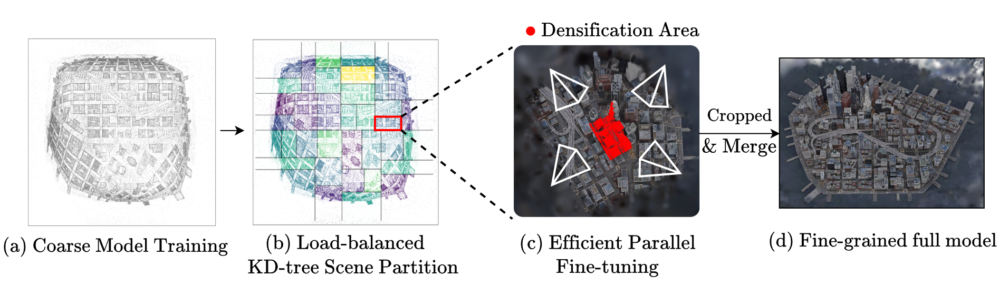

<div align="center">
<h1> LoBE-GS: Load-Balanced and Efficient 3D Gaussian Splatting for Large-Scale Scene Reconstruction</h1>
<h3>WACV 2027</h3>

<p align="center">
<a href="https://arxiv.org/abs/2510.01767"></a>
<a href="https://huggingface.co/datasets/SunnyHung/LoBE-GS-dataset"></a>
<a href="https://hub.docker.com/r/sunnyhong/lobegs"></a>
<a href="https://sunnyhong0326.github.io/lobe-gs/"></a>
</p>

<p>
  Sheng-Hsiang Hung<sup>1</sup>,
  Ting-Yu Yen<sup>1</sup>,
  Wei-Fang Sun<sup>2</sup>,
  Simon See<sup>2</sup>,
  Shih-Hsuan Hung<sup>1</sup>,
  Hung-Kuo Chu<sup>1</sup>
</p>

<p>
  <sup>1</sup>National Tsing Hua University &nbsp;&nbsp;
  <sup>2</sup>NVIDIA AI Technology Center (NVAITC)
</p>


</div>

<br>

## Installation

Requires an NVIDIA GPU and driver, Docker, and NVIDIA Container Toolkit.
The commands below use Bash syntax; on Windows, use a WSL2 Bash shell.

```bash
git clone --recurse-submodules https://github.com/Sunnyhong0326/lobe-gs.git
cd lobe-gs
docker pull sunnyhong/lobegs:latest

# Set host directories for datasets and results.
export DATA=/absolute/path/to/LoBE-GS-dataset
export OUTPUT=/absolute/path/to/output
mkdir -p "$DATA" "$OUTPUT"

docker run --rm -it --gpus all --shm-size 32gb \
  -v "$PWD":/app -v "$DATA":/data -v "$OUTPUT":/app/output \
  -e LOBEGS_DATA_ROOT=/data -e LOBEGS_OUT_DIR=/app/output \
  -w /app sunnyhong/lobegs:latest bash
```

Run all remaining commands **inside the container**.

## Data Preparation and Training


### 1. Dataset
We use MatrixCity BigCity, MatrixCity SmallCity, Rubble, Building, Residence and Sci-Art datasets. Preprocessed datasets are available on [LoBE-GS-dataset](https://huggingface.co/datasets/SunnyHung/LoBE-GS-dataset)

Download [LoBE-GS-dataset](https://huggingface.co/datasets/SunnyHung/LoBE-GS-dataset)
into the mounted data directory:

```bash
hf download SunnyHung/LoBE-GS-dataset --repo-type dataset \
  --local-dir "$LOBEGS_DATA_ROOT"

# Required before running BigCity: extract the train/test image archives.
python tools/extract_bigcity.py "$LOBEGS_DATA_ROOT/original-poses/mc_bigcity"
```

The extraction script deletes TAR inputs after successful extraction.

- `original-poses/`: preprocessed datasets with original camera poses for MatrixCity SmallCity and BigCity, Mill 19, and UrbanScene3D.
- `refined-poses/`: datasets with refined camera poses for Mill 19 and UrbanScene3D.

#### Optimization

```bash
# Original poses: 1 Building, 2 Rubble, 3 Residence, 4 Sci-Art, 5 SmallCity.
python exp/base_exp.py --scene-id 1

# Refined poses + bilateral grid: 1 Building, 2 Rubble, 3 Residence, 4 Sci-Art.
python exp/refined_cam_bilgrid_exp.py --scene-id 1

# BigCity parent/child pipeline.
python exp/bigcity_exp.py --scene-id 1
```

Results are saved under `/app/output` (the host's `$OUTPUT` directory).

### 2. Custom dataset

Reconstruct and undistort your photos with COLMAP, then split the reconstruction.

```bash
python convert.py -img /data/photos -o /data/colmap_scene
python tools/train_test_split.py --input /data/colmap_scene \
  --output /data/my_scene --stride 8
```

The splitter assigns filename-sorted images at zero-based indices 0, 8, 16, ...
to the test set.

Use undistorted `PINHOLE` or `SIMPLE_PINHOLE` cameras, with both splits sharing
one coordinate system and the following layout:

```text
/data/my_scene/
  train/
    images/
    sparse/0/{cameras.bin,images.bin,points3D.bin}
  test/
    images/
    sparse/0/{cameras.bin,images.bin,points3D.bin}
```

#### Optimization

```bash
# Run coarse training, partitioning, fine training, merging, and test evaluation
python main.py \
  pipeline.mode=train_full \
  pipeline.source_path=/data/my_scene \
  pipeline.out_dir=/app/output pipeline.exp_name=custom \
  pipeline.train_dir=train pipeline.test_dir=test \
  pipeline.pretrained_coarse_model_path=/app/output/custom/my_scene/coarse \
  pipeline.resolution=4 pipeline.num_blocks=8 \
  'pipeline.xyz_plane=[1,1,0]' pipeline.align_enabled=false \
  partition.partition_params.contracted_space=false
```

See the [configuration and argument guide](doc/arguments.md) for YAML defaults,
pipeline modes, and command-line overrides.

## Acknowledgements
The repo is built upon [CityGaussian](https://github.com/Linketic/CityGaussian/tree/V1-original), [BilaRF](https://github.com/yuehaowang/bilarf), [VastGaussian](https://github.com/kangpeilun/VastGaussian), [CLM-GS](https://github.com/nyu-systems/CLM-GS#dataset-preparation). Thanks for their great work!

We are also deeply grateful to Taiwan's National Science and Technology Council (NSTC) and the NVIDIA AI Technology Center (NVAITC) for their extraordinary support.
## Citation

If you use this repository, please cite:

```bibtex
@misc{hung2025lobe_gs,
  title         = {LOBE-GS: Load-Balanced and Efficient 3D Gaussian Splatting for Large-Scale Scene Reconstruction},
  author        = {Sheng-Hsiang Hung and Ting-Yu Yen and Wei-Fang Sun and Simon See and Shih-Hsuan Hung and Hung-Kuo Chu},
  year          = {2025},
  eprint        = {2510.01767},
  archivePrefix = {arXiv},
  primaryClass  = {cs.CV},
  doi           = {10.48550/arXiv.2510.01767},
  url           = {https://arxiv.org/abs/2510.01767}
}
```
